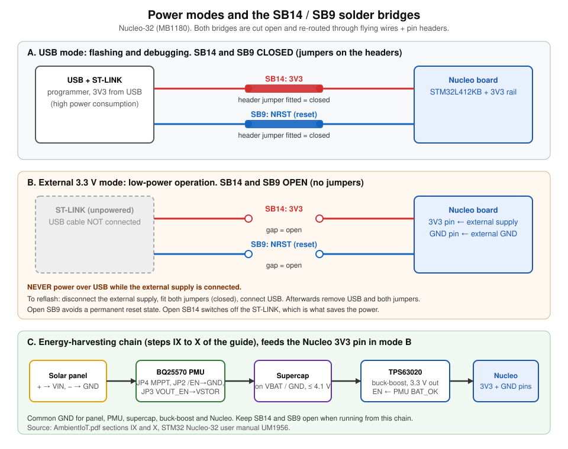

# Ambient IoT Project

A low-power, solar-powered sensor node that measures **temperature, humidity and soil moisture** and sends the readings to a smartphone over **Bluetooth Low Energy**.

```
 SHT3x / SHT4x ──I2C──┐
                      ├─► STM32 Nucleo L412KB ──UART (STX..ETX frame)──► Seeed XIAO nRF52840 ──BLE──► Phone
 Soil moisture ──ADC──┘        (sensing)                                   (UART→BLE bridge)
      ▲ GPIO power switch (PB1)
                                        ▲
 Solar panel ─► BQ25570 PMU ─► Supercap ─► TPS63020 buck-boost (3.3 V) ─┘
```

The full build guide is in [AmbientIoT.pdf](AmbientIoT.pdf). This README is the team's single source of truth for **what is done, what comes next, and how we work together** (Scrum).

_Last updated: 2026-11-21 (code at commit `a0b05fa`)._

**Quick links:** [Wiring sketch](#wiring) · [SB9 / SB14 notes](#sb9-sb14) · [Roadmap](#2-roadmap-in-steps) · [Backlog](#3-product-backlog) · [Scrum](#4-how-we-run-scrum)

---

## 1. Where we are

### Summary

The **unoptimized baseline is built, verified and tested** by the team: the STM32 firmware and the XIAO BLE sketch work together and the data reaches the phone. The Nucleo has been modified for external power (SB14 and SB9, re-soldered after a first bad attempt, see [SB9 / SB14](#sb9-sb14)). **Next up is measuring the baseline with the PPK2 and then optimizing.** Energy harvesting, the phone-side tooling and the report have not started.

### Done

| Step | What | Evidence in the repo |
|---|---|---|
| Project setup | Repository created from template, plan written | `d1de8d3`, `5534ef4` |
| Project setup | Old project removed (with committed build output and `.DS_Store`), clean STM32CubeIDE project added, `.gitignore` added | `cfe9ed4`, `3f11af0`, `a0b05fa` |
| STM32 baseline | CubeMX project for the **STM32L412KB**: MSI 4 MHz, I2C1 (PB6/PB7), ADC1 ch. 9 on PA4, USART1 (PA9/PA10) to the XIAO and USART2 (VCP) at 115200 8N1, PB1 as soil-sensor power switch, LSE enabled | `AmbientIoT_STM32/AmbientIoT.ioc`, `Core/Src/main.c` |
| STM32 baseline | SHT3x I2C driver with **CRC-8 checking** on both words, one-shot measurement with clock stretching | `Core/Src/sht3x.c` |
| STM32 baseline | Measurement loop: read SHT, power the moisture sensor, wait, read ADC, power it off, then send an `0x02 <text> 0x03` frame on USART1 | `Core/Src/main.c` |
| BLE baseline | XIAO nRF52840 sketch: advertises as `IoT_Node`, Nordic UART service, STX/ETX state machine on `Serial1`, forwards each frame to the phone, overflow guard | `unoptimized_BLE_full_connection/unoptimized_BLE_full_connection.c.ino` |
| Verification | **Baseline code verified and tested by the team** (breadboard wired, sensors read, STM32 → XIAO → phone working) | team report, no committed log yet |
| Documentation | Wiring sketch and power / solder-bridge sketch added | `docs/wiring.svg`, `docs/power-and-solder-bridges.svg` |
| Hardware | SB14 and SB9 on the Nucleo desoldered and re-soldered with wires + pin headers after the first attempt was not correct | see [SB9 / SB14](#sb9-sb14) |

### Not done yet

| Area | Status |
|---|---|
| Baseline power profile (PPK2) | Not started. No measurements committed |
| Calibration and stability evidence | Soil-moisture calibration, 30 min no-drop run and a reference-thermometer check are not recorded anywhere. Commit a short note or log so the verification is traceable |
| Optimized firmware (STOP2 sleep, burst beaconing) | Not started in the new project (see note below) |
| PMU, supercap, buck-boost, solar | Not started or not tracked yet (SB14/SB9 mod is the first part of this step) |
| Phone side (decoder, logger, plot) | Not started. nRF Connect is the minimum |
| Report and demo | Not started |

> **Note:** an earlier project (`IoT_test`) had STOP2 + RTC wake-up code (30 s cycle). It was deleted from the working tree in `cfe9ed4` but is still in git history (`git show cfe9ed4~1:IoT_test/IoT_test/Core/Src/main.c`). The new `AmbientIoT.ioc` has **no RTC configured**, so that code has to be re-created in the new project, not copied blindly. It used an SHT31 command path and had its own issues.

### Known issues in the current code

Found by reading `main.c`, `sht3x.c` and the XIAO sketch. The code works end to end, but these are still present in the committed source (unchanged since commit `a0b05fa`). Each one is a candidate backlog item (section 3). If you already fixed any of them locally, commit the fix and strike it here.

| # | Issue | Where |
|---|---|---|
| K1 | **Sensor model: document it.** The driver and `main.c` are for the **SHT3x** (address `0x44`, command `0x2C06`, status-register check `0x8010`), while the guide wires an **SHT40**, which uses a different command (`0xFD`) and has no status register. The code works with our hardware, so write down which part is actually fitted and keep only that code path | `sht3x.c`, `main.c` |
| K2 | **Sensor read result is ignored.** `Read_Sensors()` discards the `bool` return value of the SHT read, so a failed or CRC-failed read sends stale/zero data with no error | `main.c:83` |
| K3 | **`printf` goes nowhere.** `__io_putchar` is not implemented, so the "SHT31 found / not found" message and any debug output is lost. Retarget to USART2 behind a `DEBUG` macro | `main.c:183`, `syscalls.c` |
| K4 | **Humidity sent as an integer %** (driver returns whole percents), while temperature has 0.01 °C resolution | `sht3x.c:20` |
| K5 | **Soil moisture is uncalibrated.** It is sent as `raw / 4095 × 100`, which is not a real moisture percentage. Needs a dry/wet calibration | `main.c:103` |
| K6 | **ADC is not calibrated** (`HAL_ADCEx_Calibration_Start` is never called) and the sample time is the minimum 2.5 cycles, probably too short for the soil sensor's output impedance | `main.c:321` |
| K7 | **Payload is a human-readable text string** (`Moist=… Temp=… Hum=…`, about 35 bytes). Fine for the baseline, but the optimized beacon needs a compact binary format (see PB-17) | `main.c:117` |
| K8 | **Baseline wastes power by design**: `HAL_Delay(1000)` moisture settle plus `HAL_Delay(1000)` loop delay, no sleep, no RTC. This is expected for the unoptimized profile, but it is the main target for optimization | `main.c:93,204` |
| K9 | **XIAO sketch**: TX power is `+4 dBm` (guide target for the optimized version is `-4 dBm`), the file is named `*.c.ino`, and the `loop()` busy-polls the UART | `*.ino` |
| K10 | `Error_Handler()` spins forever with interrupts off. Fine for development, but a hang is silent in the field (consider a watchdog later) | `main.c:490` |
| K11 | Setting GPIOA to analog before sleep (once we add STOP2) also disables **SWD pins PA13/PA14**. Have a reflash recovery procedure written down before we get there | future |

<a id="wiring"></a>

### Wiring

Breadboard wiring for the baseline (from guide section II, checked against `AmbientIoT.ioc`). Full sketch: [docs/wiring.svg](docs/wiring.svg).


| Component | Pin | Nucleo pin | STM32 pin | Function |
|---|---|---|---|---|
| SHT sensor | VIN | 3V3 | n/a | 3.3 V supply |
| SHT sensor | GND | GND | n/a | Ground |
| SHT sensor | SDA | D4 | PB7 | I2C1_SDA |
| SHT sensor | SCL | D5 | PB6 | I2C1_SCL |
| Soil moisture | VCC | D6 | PB1 | GPIO output, **High = sensor on**, Low = off |
| Soil moisture | DATA | A3 | PA4 | ADC1_IN9 |
| Soil moisture | GND | GND | n/a | Ground |
| XIAO | RX (D7) | D1 | PA9 | USART1_TX, STM32 → XIAO |
| XIAO | TX (D6) | D0 | PA10 | USART1_RX, XIAO → STM32 |
| XIAO | 3V3 | 3V3 | n/a | **Only when the XIAO is not powered by its own USB-C** |
| XIAO | GND | GND | n/a | Common ground (always) |
| PC (debug) | USB | n/a | PA2 / PA3 | USART2 via ST-LINK virtual COM port, no wiring |

Rules: all grounds common; never join the 3V3 rails of two USB-powered boards (regulator contention); check every wire with a multimeter before power-up. The XIAO pin numbers (D6/D7) are the XIAO nRF52840 hardware UART used by `Serial1` in the sketch.

<a id="sb9-sb14"></a>

### SB9 / SB14 (Nucleo solder bridges)

To run from an external 3.3 V supply we must disconnect the on-board ST-LINK, which draws too much power. This is done by opening two solder bridges on the Nucleo-32 board. Sketch of both modes and the harvesting chain: [docs/power-and-solder-bridges.svg](docs/power-and-solder-bridges.svg).



| Bridge | What it connects | Why we open it |
|---|---|---|
| **SB14** | Board 3V3 to the ST-LINK programmer | Cuts the power-hungry ST-LINK |
| **SB9** | ST-LINK reset line to the MCU NRST | Stops the MCU being held in permanent reset |

| Mode | SB14 / SB9 | Power source |
|---|---|---|
| Flashing, debugging, USB baseline | **Closed** (jumpers on the headers) | USB |
| Low-power / external run | **Open** (no jumpers) | External 3.3 V on the 3V3 and GND pins |

**What happened:** the first soldering of SB9 and SB14 was not done correctly, so both bridges were desoldered and soldered again.

**Procedure and lessons (use this next time or on a second kit):**

1. Desolder the bridge pad cleanly (wick or pump) and **check there is no solder left shorting the two pads** before adding wires.
2. Solder a thin flexible wire to **each** of the two pads, with a short, tidy joint. These pads are very small and delicate: use a fine tip, low heat time, and avoid pulling the wire (strain-relieve it, e.g. a dab of hot glue or tape).
3. Terminate each wire pair on a **pin header** so the bridge can be closed with a jumper. Label which pair is SB14 and which is SB9. A photo of the finished board goes in `docs/`.
4. **Multimeter checks, in this order:** with the jumper fitted, continuity across each pair (closed); with the jumper removed, no continuity (open); no short between neighbouring pads, 3V3 and GND.
5. Test in USB mode first (jumpers fitted): the board must power up, flash and run. Only then test external mode (jumpers removed, USB unplugged).
6. If the system misbehaves, suspect these joints first: a bad SB9 joint gives resets or a stuck reset state, a bad SB14 joint gives no power or an unstable supply in USB mode. Then check that the supply + is on the 3V3 pin and − is on GND.

**Golden rule:** never power over USB while the external supply is connected. To reflash, disconnect the external supply, close both bridges, connect USB; when done, remove USB and both jumpers.

> If the soldering has since been verified (continuity checks and a successful USB flash plus external-power run), tick PB-27 in the backlog and add the photo.

---

## 2. Roadmap in steps

Each step has a goal and a **gate**: we only call it finished when the gate is met. Statuses are updated by whoever finishes a backlog item.

| Step | Goal | Status | Gate (done when…) |
|---|---|---|---|
| **0. Setup** | Repo clean, rules agreed, scope known | 🟡 Mostly done | Course **deadline and deliverables** confirmed and written in section 6. Team agreements in section 4 accepted. Kit inventory done |
| **1. Baseline code** | Unoptimized STM32 + XIAO firmware written | ✅ Done | Code committed |
| **2. Baseline on hardware** | Real data on a phone | ✅ Done (team-verified) | Temperature, humidity and moisture reach the phone, code tested. Still to record: calibration and stability evidence (PB-13, PB-14) |
| **3. Baseline profile** | Know what the unoptimized node costs | ⬜ **Next** | `.ppk` + `.csv` of a 5 s connected-BLE profile committed (expected: about 10 mA floor, 25–30 mA BLE spikes) |
| **4. Optimization** | Hit about 0.6 mA floor and about 12 mA peaks on a 30 s cycle | ⬜ | PPK2 traces show STOP2 floor, active sensing and BLE burst. Average current computed. Each gain measured separately |
| **5. External power** | Run from supercap + PMU + solar | 🟡 Started (SB14/SB9 re-done) | Node boots from a partly charged supercap, browns out and recovers by itself. Energy budget written |
| **6. Phone and data** | Presentable data path | ⬜ (can run in parallel from step 2) | Decoder + logger + plot working on beacon data |
| **7. Integration and wrap-up** | Prove it and deliver it | ⬜ | 24 h unattended run, baseline-vs-optimized table, report, demo, tagged release that builds from a fresh clone |

```
[0 Setup] → [1 Baseline code] → [2 On hardware] → [3 Baseline profile] → [4 Optimize] → [5 Ext. power] → [7 Wrap-up]
                                        └──────────── [6 Phone & data, in parallel] ───────────────────┘
```

### Next steps (in order)

1. **Confirm the deadline and deliverables** (report? demo? presentation?) and fill in section 6. Everything else is paced from this.
2. **Agree the Scrum roles and hold Sprint Planning for Sprint 2** (section 4).
3. **Verify the SB14 / SB9 rework** with the multimeter checklist and photograph it (PB-27), so the board is safe to use for the PPK2 and external-power work.
4. **Capture the baseline PPK2 profile** (PB-15, PB-16) and commit it with a conditions note.
5. **Close the loose ends of the baseline**: write down which SHT part is fitted (K1), handle failed reads (K2), route `printf` to USART2 (K3), calibrate the ADC and soil moisture (K5, K6), and commit the evidence of the 30 min run.
6. **Start optimization**: define the binary beacon payload (PB-17), then STOP2 with RTC (PB-18).

---

## 3. Product backlog

The backlog is the single ordered list of everything left to do. **Top = do first.** Items are **not assigned** here: people pull items during Sprint Planning. Items should live as GitHub Issues on a Project board (columns: `Backlog`, `Sprint`, `In progress`, `In review`, `Done`) so this table can stay a readable summary. Sizes are rough (S about half a day, M about a day, L several days) and get refined in Sprint Planning.

Legend: Step = roadmap step from section 2. Status: ⬜ todo, 🔵 in progress, ✅ done.

### Setup and process

| ID | Item | Step | Size | Status |
|---|---|---|---|---|
| PB-01 | Confirm course deadline and deliverables; fill section 6 | 0 | S | ⬜ |
| PB-02 | Agree team roles (PO, Scrum Master), sprint length, meeting slot, chat channel (section 4) | 0 | S | ⬜ |
| PB-03 | Inventory the kits: how many complete sets, who holds what, bench booking method | 0 | S | ⬜ |
| PB-04 | Create the GitHub Project board and issue labels; move this backlog into issues | 0 | S | ⬜ |
| PB-05 | Add `docs/` and `measurements/` folders; add a measurement note template (supply, interval, firmware commit) | 0 | S | ⬜ |

### Baseline verification (Step 2)

| ID | Item | Step | Size | Status |
|---|---|---|---|---|
| PB-06 | Record which SHT part is fitted (K1); keep one driver path and remove the other | 2 | S | ⬜ |
| PB-07 | Check the read result and handle failures in `Read_Sensors()` (K2); keep humidity resolution (K4) | 2 | S | ⬜ |
| PB-08 | Retarget `printf` to USART2 behind a `DEBUG` macro (K3) | 2 | S | ⬜ |
| PB-09 | Wire the breadboard per the guide table and verify with a multimeter (SHT on PB6/PB7, moisture VCC on PB1, data on PA4, XIAO on PA9/PA10, common GND). Pin table and wiring sketch are in section 1. _Still to add:_ a photo of the real breadboard in `docs/` | 2 | M | ✅ |
| PB-10 | Verify CubeMX settings against the guide and flash the STM32; confirm frames with a serial terminal | 2 | M | ✅ |
| PB-11 | Flash the XIAO sketch; confirm STM→XIAO frames on `Serial`, then BLE data in nRF Connect (rename the sketch file to `.ino`) | 2 | M | ✅ |
| PB-12 | ADC calibration call and longer sample time (K6) | 2 | S | ⬜ |
| PB-13 | Soil moisture calibration: record raw ADC in dry air and in water, define the percentage mapping (K5) | 2 | M | ⬜ |
| PB-14 | Record the 30 min stability run: no dropped frames, values plausible against a reference thermometer. Commit a short log or note as evidence | 2 | S | ⬜ |

### Baseline measurement (Step 3)

| ID | Item | Step | Size | Status |
|---|---|---|---|---|
| PB-15 | Set up PPK2 in series with the bench supply (3.3 V, 100 mA limit), Ampere Meter mode | 3 | S | ⬜ |
| PB-16 | Capture and commit the 5 s connected-BLE profile (`.ppk` + `.csv`) in `unoptimized_BLE_full_connection/` with a conditions note | 3 | M | ⬜ |

### Optimization (Step 4)

| ID | Item | Step | Size | Status |
|---|---|---|---|---|
| PB-17 | Define the **binary beacon payload** (byte order, scaling, e.g. int16 temp ×100, uint16 RH ×100, uint16 moisture) and document it in `docs/`; shared contract between STM32, XIAO and phone | 4 | S | ⬜ |
| PB-18 | Add RTC wake-up to the new `.ioc`; implement STOP2 sleep with a single interval constant (30 s demo value). Port ideas from the old `IoT_test` code from history, do not copy blindly (see note in section 1) | 4 | L | ⬜ |
| PB-19 | Remove active waits, keep only what sensors need (about 15 ms SHT, about 10 ms moisture settle); put all GPIO to analog before sleep | 4 | M | ⬜ |
| PB-20 | Write the SWD recovery procedure (K11) in `docs/` before enabling GPIO analog mode | 4 | S | ⬜ |
| PB-21 | Verify STOP2 over many cycles: clocks restored, peripherals re-initialised, no hang | 4 | M | ⬜ |
| PB-22 | XIAO **burst beacon** sketch: `0xFF` wake byte interrupt, pack the payload into Manufacturer Specific Data, advertise every 100 ms for 2 s, then stop radio and sleep | 4 | L | ⬜ |
| PB-23 | XIAO hardware settings: TX power -4 dBm, DC-DC enabled, LEDs off (K9) | 4 | S | ⬜ |
| PB-24 | Desolder the SHT breakout LED; check the XIAO and Nucleo power LEDs | 4 | S | ⬜ |
| PB-25 | Profile after each change (STOP2, then beaconing, then LED removal) so each gain is attributed; commit every run under `measurements/` | 4 | M | ⬜ |
| PB-26 | Confirm the phone receives the beacon reliably (2 s window, cycle time not a multiple of the advertising interval, several phones) | 4 | M | ⬜ |

### External power (Step 5)

Follow the guide's power sections in order and test after each step. Do not skip multimeter checks. **Never power over USB while an external supply is connected.**

| ID | Item | Step | Size | Status |
|---|---|---|---|---|
| PB-27 | Desolder SB14 and SB9, add flying wires and headers (open = external 3.3 V, closed = USB for flashing). **Re-done after the first soldering was incorrect.** To close: multimeter checks (closed/open/no shorts), USB flash test, external-power run, photo in `docs/` (see [SB9 / SB14](#sb9-sb14)) | 5 | M | 🔵 |
| PB-28 | TPS63020 buck-boost: headers, only the 3.3 V bridge closed, test VOUT stays 3.3 V for VIN from 5 V down to 2 V | 5 | M | ⬜ |
| PB-29 | Charge the supercap to 4 V max (1 A limit) and run the node from cap + buck-boost | 5 | M | ⬜ |
| PB-30 | BQ25570EVM PMU: cap on VBAT/GND, buck-boost EN to BAT_OK, jumpers JP4 / JP2 / JP3; keep the cap below 4.1 V | 5 | L | ⬜ |
| PB-31 | Solar panel on VIN/GND and brown-out test (charge to about 3.2 V, drain under about 2.8 V, recharge to about 3 V and confirm restart) | 5 | M | ⬜ |
| PB-32 | Energy budget: average current × 3.3 V, supercap runtime `t = C × dV / I_avg`, harvested power needed to break even by a window and in indoor light | 5 | M | ⬜ |

### Phone and data (Step 6)

| ID | Item | Step | Size | Status |
|---|---|---|---|---|
| PB-33 | Decoder + logger, e.g. a Python script with `bleak` that scans, decodes and writes timestamped CSV (needs PB-17) | 6 | M | ⬜ |
| PB-34 | Simple plot or dashboard of the logged data for the demo | 6 | M | ⬜ |
| PB-35 | _Optional:_ small phone app or web page. Only if everything else is on track | 6 | L | ⬜ |

### Integration and wrap-up (Step 7)

| ID | Item | Step | Size | Status |
|---|---|---|---|---|
| PB-36 | 24 h unattended run on solar + supercap; log supercap voltage, received packets and gaps | 7 | L | ⬜ |
| PB-37 | Review the known-issues list: every item fixed or explicitly accepted | 7 | S | ⬜ |
| PB-38 | Comparison table: baseline vs optimized (floor, peak, average current, supercap runtime) with PPK2 screenshots | 7 | M | ⬜ |
| PB-39 | Report and presentation/demo script (everyone writes their own area, one person assembles) | 7 | L | ⬜ |
| PB-40 | Freeze `main`, tag the release, verify a fresh clone builds and flashes | 7 | S | ⬜ |

---

## 4. How we run Scrum

This is a small university team on a fixed deadline with shared hardware, so we use a **light Scrum**: the real value is a visible ordered backlog, short feedback loops and honest "done". Everything below is a proposal to be accepted or changed in the first meeting (PB-02).

### Roles

| Role | Who | Responsibility |
|---|---|---|
| Product Owner | _TBD_ | Owns the backlog order and what "done" means for the course deliverable. Final say on priority |
| Scrum Master | _TBD (rotate each sprint)_ | Runs the events, removes blockers, books bench time, keeps this README current |
| Developers | _everyone_ | Pull items from the sprint backlog, build, test, review each other's work |

Nobody is a fixed "owner" of an area. Because hardware is shared, **anyone may pick any item**, and we pair up on bench work. The Product Owner and Scrum Master can be developers too.

### Cadence (proposal)

- **Sprint length:** 1 week (the project is only a few weeks long, so short loops matter). Sprint dates are set once the deadline is known (PB-01).
- **Sprint Planning (start of sprint, about 45 min):** PO proposes a **Sprint Goal**, the team pulls items from the top of the backlog until it is realistic, splits anything bigger than "L", and notes who needs the bench and when.
- **Daily check-in:** 10 min in person on bench days, or an async post in the team chat: *what I finished, what I do next, what blocks me*. Hardware blockers (broken board, missing part) are raised immediately, not at the next meeting.
- **Sprint Review (end of sprint, about 30 min):** demo the working increment on the real hardware (or show the measurement). Update the Current status tables in this README and re-order the backlog.
- **Retrospective (about 20 min):** one thing to keep, one to change. Write the agreed change into the next sprint's backlog.
- **Backlog refinement:** a short slot mid-sprint to size and clarify the next sprint's top items.

### Definition of Ready (an item may enter a sprint when…)

- Its goal and acceptance criteria are clear in one or two sentences.
- Hardware, parts or bench time it needs are available or booked.
- It is small enough to finish within the sprint.

### Definition of Done (an item is done when…)

- It meets its acceptance criteria and was **tested on the real hardware** where it touches hardware.
- The change went through a **pull request reviewed by one other member** and merged to `main`; `main` always builds.
- No build output is committed. Measurements are committed with a one-line note on conditions (supply, interval, firmware commit).
- Pinout or wiring changes are reflected in the `.ioc` and the pin table in `docs/`.
- This README (status tables and the item's ✅) is updated.

### Sprint plan

**Sprint 1 (done, ran informally before this process):** *Sensor readings reach a phone over BLE on USB power.* Delivered: PB-09, PB-10, PB-11 (team-verified).

**Sprint 2 proposal.** Goal: *A committed, trustworthy baseline power profile, on a safely re-worked board.*

Candidate items (to confirm in Sprint Planning): PB-01, PB-02, PB-27 (verify SB14/SB9), PB-15, PB-16, plus the baseline loose ends PB-06, PB-07, PB-08, PB-12, PB-13, PB-14. Stretch: PB-17, PB-05.

**Sprint 3 (expected):** start optimization (PB-17 to PB-21). Later sprints are planned from what we learn.

### Working agreements

- One branch per backlog item, named `<area>/<id>-<short-name>`, e.g. `firmware/pb-08-printf-debug`, `ble/pb-22-burst-beacon`.
- Pull requests into `main`, one reviewer, link the backlog ID in the PR title.
- After changing the pinout in CubeMX, regenerate and keep custom code inside the `USER CODE` blocks.
- Commit sketches, source, `.ioc` and measurement exports (`.csv`, `.ppk`). Do not commit build output.
- Update the "Where we are" section of this README at the end of every sprint.

---

## 5. Repository layout

| Path | What it is |
|---|---|
| `AmbientIoT.pdf` | Course user guide (wiring, CubeMX settings, framing protocol, PMU, profiling, optimizations) |
| `AmbientIoT_STM32/` | **STM32CubeIDE project** for the Nucleo L412KB (`AmbientIoT.ioc`, firmware in `Core/Src/main.c`, SHT3x driver in `Core/Src/sht3x.c`) |
| `docs/` | Wiring sketch (`wiring.svg`) and power / solder-bridge sketch (`power-and-solder-bridges.svg`). Photos and the pin table also go here |
| `unoptimized_BLE_full_connection/` | XIAO nRF52840 sketch for the connected BLE UART baseline (PPK2 profile to be added here) |
| `optimized_BLE_burst_beaconing/` | _Not created yet._ Will hold the burst-beacon sketch and its profile (PB-22) |
| `measurements/` | _Not created yet_ (PB-05) |

---

## 6. Milestones

| # | Milestone | Target date | Gate |
|---|---|---|---|
| M0 | Team organised, deadline known | _TBD_ | PB-01 to PB-04 done |
| M1 | Data on phone (USB power) | ✅ reached (date to record) | Step 2 gate |
| M2 | Baseline profile captured | _TBD_ | Step 3 gate |
| M3 | Optimized profile captured | _TBD_ | Step 4 gate |
| M4 | Runs from supercap + PMU + solar | _TBD_ | Step 5 gate |
| M5 | 24 h autonomous test passed | _TBD_ | PB-36 |
| M6 | Report and demo delivered | _TBD_ | Course deadline |

Course deadline and deliverables: **_not confirmed yet_ (PB-01)**.

---

## 7. Risks and open questions

| Risk / question | Mitigation |
|---|---|
| Only a few kits shared by the whole team | Book bench time, pair up, keep a shared wiring photo and pin table so a setup can be rebuilt fast |
| Which SHT sensor do we actually have (K1)? | Check the part marking and run the presence check before writing more code (PB-06) |
| Losing SWD access after setting GPIOA to analog (K11) | Write the recovery procedure first (PB-20) |
| STOP2 code from the old project does not fit the new `.ioc` | Re-create the RTC in CubeMX, port selectively from git history (PB-18) |
| **SB14/SB9 joints fail (already happened once: first soldering was not correct and had to be redone)** | Follow the checklist in [SB9 / SB14](#sb9-sb14): multimeter checks before power, test in USB mode first, strain-relieve the wires, photograph the result. If it fails again suspect these joints first |
| Desoldering the LED (or other parts) damages a board | Let the most experienced solderer do it once, photograph the result |
| Supercap over-voltage (above 4.1 V) damages the PMU | Always measure with a multimeter before connecting to VBAT |
| Beacon not caught by the phone in the 2 s window | Test with several phones, tune interval and window, consider a longer burst (PB-26) |
| Indoor light too weak to sustain 30 s cycles | Use the energy budget (PB-32) to choose a longer interval |
| Course deliverables and deadline not confirmed | PB-01 is the first backlog item |
