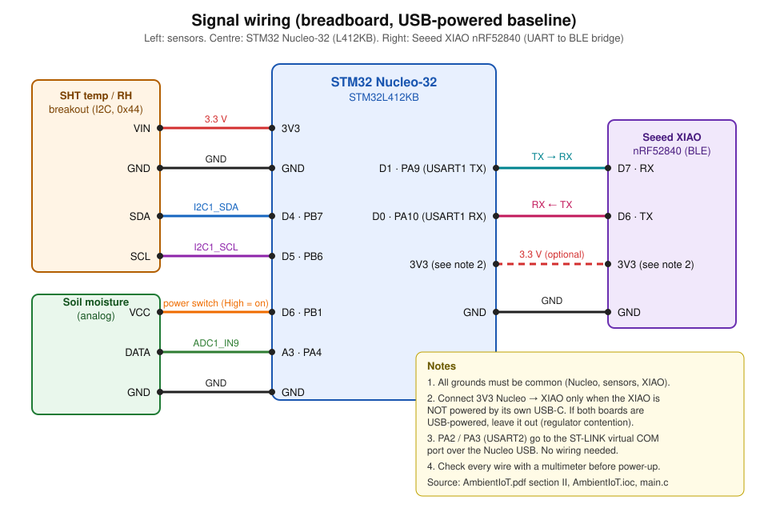
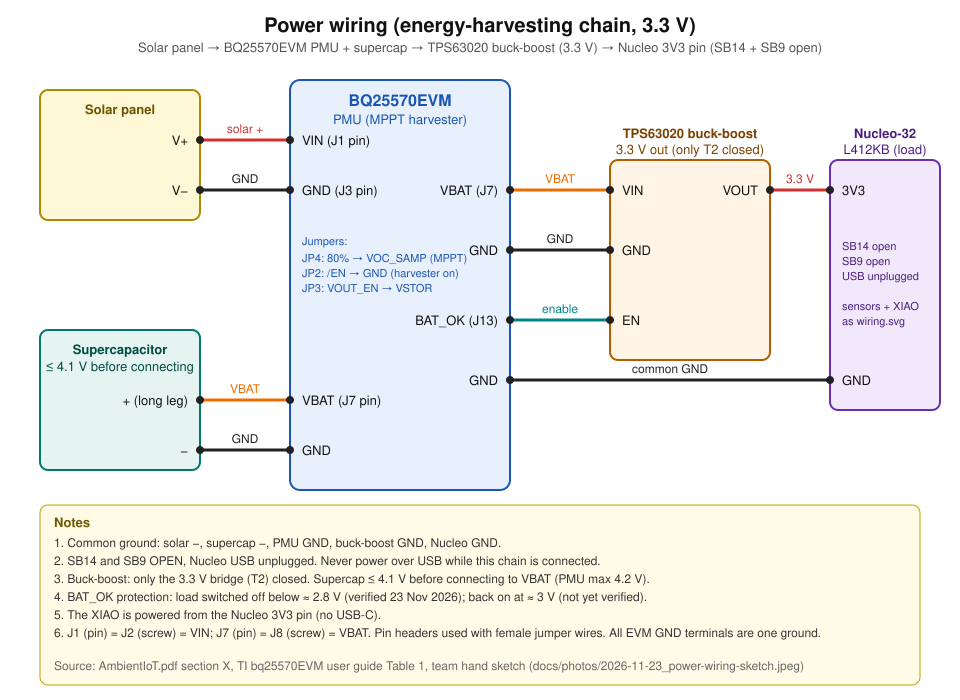

# Ambient IoT Project

A low-power, solar-powered sensor node that measures **temperature, humidity and soil moisture** and sends the readings to a smartphone over **Bluetooth Low Energy**.

```
 SHT3x / SHT4x ──I2C──┐
                      ├─► STM32 Nucleo L412KB ──UART (STX..ETX frame)──► Seeed XIAO nRF52840 ──BLE──► Phone
 Soil moisture ──ADC──┘        (sensing)                                   (UART→BLE bridge)
      ▲ GPIO power switch (PB1)
                                        ▲ Nucleo 3V3 pin (SB14 + SB9 open)
 Solar panel ─► BQ25570 PMU ─► Supercap ─► TPS63020 buck-boost (3.3 V) ─┘
```

The build guide is [AmbientIoT.pdf](AmbientIoT.pdf). The team follows it as written: **3.3 V everywhere, ST-LINK disconnected through SB14 / SB9**. This README is the team's single source of truth for **what is done, what comes next, and how we work together** (Scrum).

_Last updated: 2026-11-24._

> **Deadline: Monday 4 January 2027. Deliverable: the project report**, containing the four items in [Report deliverables](#deliverables). The dated plan is in [section 4](#sprint-plan) and [section 6](#6-milestones).

**Quick links:** [Deliverables](#deliverables) · [Latest session](#latest-session) · [Wiring](#wiring) · [Power wiring](#power-wiring) · [SB9 / SB14](#sb9-sb14) · [Roadmap](#2-roadmap-in-steps) · [Backlog](#3-product-backlog) · [Scrum](#4-how-we-run-scrum)

---

## 1. Where we are

### Summary

The **unoptimized node works end to end and runs from harvested energy**. The baseline firmware (STM32 + XIAO) delivers sensor data to the phone. On 23 Nov 2026 the team completed the guide's power chain (sections IX and X): the node ran from the supercap through the 3.3 V buck-boost and PMU, solar harvesting was confirmed, and sensor data reached the phone on that power. **Next is collecting the unoptimized report evidence** (tagged code, photos, nRF Connect screenshots, PPK2 profile), then optimization.

<a id="latest-session"></a>

### Latest sessions

**24 Nov 2026**

| Outcome | Status |
|---|---|
| nRF Connect showed an empty value although data arrived (visible only in the log). Cause: the XIAO sent each reading as several notifications (default 20-byte packets plus a separate `"
"` write), so the app showed only the last one, a bare newline. **Fixed in the XIAO sketch**: larger MTU (`configPrphBandwidth(BANDWIDTH_MAX)`) and one write per reading | ✅ |
| nRF Connect screenshot of live data on USB power: `ADC=61.78 Temp=25.46 C Hum=30 %` ([screenshot](docs/nrf-connect/2026-11-24_unoptimized_usb-power.jpeg)) | ✅ |
| SHT readings are plausible (25.46 °C, 30 % RH), so the fitted sensor answers the SHT3x driver (K1 mostly resolved; part marking still to note) | ✅ |
| **Firmware on the board differs from git**: it sends `ADC=…`, the committed `main.c` sends `Moist=…`. Commit the flashed STM32 code (K14) | ⚠️ |

**23 Nov 2026**

| Outcome | Guide section | Status |
|---|---|---|
| SB14 / SB9 rework confirmed good; node runs from external 3.3 V on the 3V3 pin | IX | ✅ |
| TPS63020 buck-boost set to **3.3 V** (bridge T2) and powering the Nucleo 3V3 pin | X.1–X.3 | ✅ |
| Supercap + BQ25570 PMU connected (buck-boost EN on BAT_OK) | X.4 | ✅ |
| Solar panel connected, **harvesting confirmed** (supercap charging) | X.5 | ✅ |
| **Sensor data received on the phone** with the node powered from the buck-boost | X | ✅ |
| BAT_OK cut-out: load switched off when the supercap drained below ~2.8 V | X.5 | ✅ |
| BAT_OK auto-restart: load back on when the supercap recharges to ~3 V | X.5 | ⬜ not tested yet |
| Power wiring documented: team hand sketch and a clean diagram ([Power wiring](#power-wiring)) | – | ✅ |
| Photo of the harvesting chain (solar, PMU, supercap, buck-boost) | – | ✅ taken **without the load connected**; VOUT not yet checked with a multimeter (taken outside the lab) |
| Photo with the Nucleo connected as load, nRF Connect screenshot on buck-boost power | – | ⬜ next lab session (D2, D4) |

<a id="deliverables"></a>

### Report deliverables (due Mon 4 Jan 2027)

| # | Report item | Unoptimized | Optimized | Where it lives in the repo |
|---|---|---|---|---|
| D1 | **Final code, STM32 and BLE** | 🔵 Code works; not frozen or tagged yet | ⬜ Not started | Git tags `v1-unoptimized` and `v2-optimized`; folders in [section 5](#5-repository-layout) |
| D2 | **Pictures of each hardware setup** | 🔵 Harvesting chain photographed without load ([photo](docs/photos/2026-11-23_pmu-setup-no-load.jpeg)). Still needed: USB breadboard, external 3.3 V, chain with the Nucleo as load, PPK2 setup | ⬜ | `docs/photos/`: (a) baseline breadboard on USB, (b) external 3.3 V with SB14/SB9 open, (c) supercap + buck-boost, (d) PMU + solar chain, (e) PPK2 profiling setup, (f) optimized setup (e.g. SHT LED removed) |
| D3 | **Final power profiles (PPK2 screenshots)** | ⬜ | ⬜ | `measurements/`: unoptimized 10 s and 1 s windows; optimized 10 s window, 1 s in STOP2, 1 s active sensing, 1 s BLE burst (guide section XII figure list). Keep the `.ppk`/`.csv` next to each screenshot |
| D4 | **Pictures of the data in nRF Connect** | 🔵 USB-power screenshot ✅ ([24 Nov](docs/nrf-connect/2026-11-24_unoptimized_usb-power.jpeg)). Still needed: buck-boost-power screenshot, and a retake from the tagged `v1-unoptimized` code | ⬜ | `docs/nrf-connect/`: connected UART notifications (unoptimized); scanner showing the beacon's manufacturer data (optimized) |

"Final" means taken from the tagged code: every screenshot and profile note records the firmware commit it came from. The code currently in the repo is what ran on 23 Nov; any fix made before tagging `v1-unoptimized` needs a quick re-check on hardware.

### Done

| Step | What | Evidence in the repo |
|---|---|---|
| Project setup | Repository created from template, plan written | `d1de8d3`, `5534ef4` |
| Project setup | Old project removed (with committed build output and `.DS_Store`), clean STM32CubeIDE project added, `.gitignore` added | `cfe9ed4`, `3f11af0`, `a0b05fa` |
| STM32 baseline | CubeMX project for the **STM32L412KB**: MSI 4 MHz, I2C1 (PB6/PB7), ADC1 ch. 9 on PA4, USART1 (PA9/PA10) to the XIAO and USART2 (VCP, PA2/PA15) at 115200 8N1, PB1 as soil-sensor power switch, LSE enabled | `AmbientIoT_STM32/AmbientIoT.ioc`, `Core/Src/main.c` |
| STM32 baseline | SHT3x I2C driver with **CRC-8 checking** on both words, one-shot measurement with clock stretching | `Core/Src/sht3x.c` |
| STM32 baseline | Measurement loop: read SHT, power the moisture sensor, wait, read ADC, power it off, then send an `0x02 <text> 0x03` frame on USART1 | `Core/Src/main.c` |
| BLE baseline | XIAO nRF52840 sketch: advertises as `IoT_Node`, Nordic UART service, STX/ETX state machine on `Serial1`, forwards each frame to the phone, overflow guard | `unoptimized_BLE_full_connection/unoptimized_BLE_full_connection.c.ino` |
| Verification | Baseline verified by the team: STM32 → XIAO → phone working on USB power | team report; screenshots still to commit (D4) |
| Hardware | SB14 and SB9 desoldered and re-soldered with wires + pin headers (after a first attempt that was not correct); confirmed working on 23 Nov | see [SB9 / SB14](#sb9-sb14) |
| Power chain | 3.3 V buck-boost, supercap, BQ25570 PMU and solar panel connected; harvesting confirmed; sensor data on the phone from buck-boost power; BAT_OK cut-out below ~2.8 V seen (23 Nov) | `docs/photos/2026-11-23_pmu-setup-no-load.jpeg`, `docs/photos/2026-11-23_power-wiring-sketch.jpeg` |
| Documentation | Signal wiring, power wiring and power / solder-bridge diagrams | `docs/wiring.svg`, `docs/power-wiring.svg`, `docs/power-and-solder-bridges.svg` |

### Not done yet

| Area | Status |
|---|---|
| Unoptimized report evidence | Code not tagged; photos and nRF Connect screenshots not committed; **PPK2 baseline profile not captured** |
| Calibration evidence | Soil-moisture calibration and a reference-thermometer check not recorded |
| BAT_OK restart test | Cut-out verified; restart at ~3 V not tested yet |
| Optimized firmware (STOP2 sleep, burst beaconing) | Not started in the new project (see note below) |
| Report (due 4 Jan 2027) | Not started |

> **Note:** an earlier project (`IoT_test`) had STOP2 + RTC wake-up code (30 s cycle). It was deleted from the working tree in `cfe9ed4` but is still in git history (`git show cfe9ed4~1:IoT_test/IoT_test/Core/Src/main.c`). The new `AmbientIoT.ioc` has **no RTC configured**, so that code has to be re-created in the new project, not copied blindly. A course-provided code set is in `wetransfer_ambient-iot-source-code_2026-09-11_0745/`; it has **not been reviewed yet** and will be gone through in a later session.

### Known issues in the current code

Found by reading `main.c`, `sht3x.c` and the XIAO sketch. The code works end to end, but these are still present in the committed source (unchanged since commit `a0b05fa`). If you already fixed any of them locally, commit the fix and strike it here.

| # | Issue | Where |
|---|---|---|
| K1 | **Sensor model: mostly resolved 24 Nov.** The node returns plausible values (25.46 °C, 30 % RH), so the fitted part answers the SHT3x driver. Still note the part marking. Background: The driver and `main.c` are for the **SHT3x** (address `0x44`, command `0x2C06`, status-register check `0x8010`), while the guide specifies an **SHT40** (command `0xFD`, no status register). An SHT40 would reject the SHT3x command, and because of K2 and K3 the node would then silently send `Temp=0.00 C Hum=0 %`. Check the part marking and that the phone shows plausible, changing values before the report screenshots | `sht3x.c`, `main.c` |
| K2 | **Sensor read result is ignored.** `Read_Sensors()` discards the `bool` return value of the SHT read, so a failed or CRC-failed read sends stale/zero data with no error | `main.c:83` |
| K3 | **`printf` goes nowhere.** `__io_putchar` is not implemented, so the "SHT31 found / not found" message and any debug output is lost. Retarget to USART2 behind a `DEBUG` macro | `main.c:183`, `syscalls.c` |
| K4 | **Humidity sent as an integer %** (driver returns whole percents), while temperature has 0.01 °C resolution | `sht3x.c:20` |
| K5 | **Soil moisture is uncalibrated.** It is sent as `raw / 4095 × 100`, which is not a real moisture percentage. Needs a dry/wet calibration | `main.c:103` |
| K6 | **ADC is not calibrated** (`HAL_ADCEx_Calibration_Start` is never called) and the sample time is the minimum 2.5 cycles, probably too short for the soil sensor's output impedance | `main.c:320` |
| K7 | **Payload is a labelled text string** (`Moist=… Temp=… C Hum=… %\r\n`, about 38 bytes) instead of the guide's `31.8,45.0,324`. It carries a `\r\n` inside the frame and the XIAO adds another `\n`; at the default BLE MTU (20 data bytes) it can arrive on the phone in two notifications. The **XIAO side is fixed** (24 Nov: trailing `
` stripped, one notification per reading). The STM32 side still sends the `
`; the optimized beacon needs a compact binary format (PB-17) | `main.c:117` |
| K8 | **Loop period is about 2 s, not the guide's 5 s.** `HAL_Delay(1000)` moisture settle plus `HAL_Delay(1000)` loop delay. The guide's unoptimized profile assumes a cycle every 5 s; set it to 5 s (or note the real value) before the baseline PPK2 profile | `main.c:93,204` |
| K9 | **XIAO sketch**: TX power is `+4 dBm` (optimized target is `-4 dBm`), the file is named `*.c.ino`, and the `loop()` busy-polls the UART | `*.ino` |
| K10 | `Error_Handler()` spins forever with interrupts off. Fine for development, but a hang is silent in the field | `main.c` |
| K11 | Setting GPIOA to analog before sleep (once we add STOP2) also disables **SWD pins PA13/PA14**. Write a reflash recovery procedure first | future |
| K12 | `AmbientIoT Debug.launch` contains an absolute path from one member's PC (`C:\Users\…\Desktop\…`). Make it portable or stop tracking it | `AmbientIoT_STM32/` |
| K13 | `convert_temperature()` returns `uint32_t` for a signed value; works with GCC but is fragile. Make it `int32_t` | `sht3x.c:11` |
| K14 | **Flashed STM32 firmware is not in git.** The board sends `ADC=… Temp=… C Hum=… %`, but the committed `main.c` formats `Moist=…`. Whoever has the flashed version should commit it, so the report code (D1) matches the screenshots | `main.c:118` |

<a id="wiring"></a>

### Wiring

Breadboard wiring for the baseline (guide section II, checked against `AmbientIoT.ioc`). Full sketch: [docs/wiring.svg](docs/wiring.svg).



| Component | Pin | Nucleo pin | STM32 pin | Function |
|---|---|---|---|---|
| SHT sensor | VIN | 3V3 | n/a | 3.3 V supply |
| SHT sensor | GND | GND | n/a | Ground |
| SHT sensor | SDA | D4 | PB7 | I2C1_SDA |
| SHT sensor | SCL | D5 | PB6 | I2C1_SCL |
| Soil moisture | VCC | D6 | PB1 | GPIO output, **High = sensor on**, Low = off |
| Soil moisture | DATA | A3 | PA4 | ADC1_IN9 |
| Soil moisture | GND | GND | n/a | Ground |
| XIAO | RX (D7) | D1 | PA9 | USART1_TX, STM32 → XIAO |
| XIAO | TX (D6) | D0 | PA10 | USART1_RX, XIAO → STM32 |
| XIAO | 3V3 | 3V3 | n/a | **Only when the XIAO is not powered by its own USB-C** |
| XIAO | GND | GND | n/a | Common ground (always) |
| PC (debug) | USB | n/a | PA2 (TX) / PA15 (RX) | USART2 via ST-LINK virtual COM port, no wiring. The guide says PA3; the board's `.ioc` uses PA15 |

Rules: all grounds common; never join the 3V3 rails of two USB-powered boards (regulator contention); check every wire with a multimeter before power-up; never power over USB while an external supply is connected.

<a id="power-wiring"></a>

### Power wiring (harvesting chain)

Guide section X, as built on 23 Nov 2026. Clean diagram: [docs/power-wiring.svg](docs/power-wiring.svg). Team hand sketch: [docs/photos/2026-11-23_power-wiring-sketch.jpeg](docs/photos/2026-11-23_power-wiring-sketch.jpeg). Photo (load not connected): [docs/photos/2026-11-23_pmu-setup-no-load.jpeg](docs/photos/2026-11-23_pmu-setup-no-load.jpeg).



| From | Pin | To | Pin | Purpose |
|---|---|---|---|---|
| Solar panel | V+ | BQ25570EVM | VIN, J1 pin (same net as J2 screw terminal) | Harvester input |
| Solar panel | V− | BQ25570EVM | GND, J3 pin | Input return |
| Supercap | + | BQ25570EVM | VBAT, J7 pin (same net as J8 screw terminal) | Storage (≤ 4.1 V before connecting) |
| Supercap | − | BQ25570EVM | GND | Ground |
| BQ25570EVM | VBAT | TPS63020 | VIN | Buck-boost input from the supercap |
| BQ25570EVM | GND | TPS63020 | GND | Ground |
| BQ25570EVM | BAT_OK (J13) | TPS63020 | EN | Switches the load off below ~2.8 V, back on at ~3 V |
| TPS63020 | VOUT (3.3 V, T2 closed) | Nucleo | 3V3 | Load supply (SB14 + SB9 open, USB unplugged) |
| BQ25570EVM | GND | Nucleo | GND | Common ground |

EVM connectors (TI bq25570EVM user guide, Table 1): each input has a pin header and a screw terminal on the same net, J1/J2 for VIN and J7/J8 for VBAT. We use the pin headers with female jumper wires. All EVM GND terminals are one common ground. PMU jumpers: JP4 80% → VOC_SAMP (MPPT on), JP2 /EN → GND (harvester on), JP3 VOUT_EN → VSTOR. The sensors and the XIAO stay wired to the Nucleo as in [Wiring](#wiring), with the XIAO powered from the Nucleo 3V3 pin.

<a id="sb9-sb14"></a>

### SB9 / SB14 (Nucleo solder bridges)

To run from 3.3 V we disconnect the power-hungry on-board ST-LINK by opening two solder bridges (guide section IX). Sketch of both modes and the harvesting chain: [docs/power-and-solder-bridges.svg](docs/power-and-solder-bridges.svg).


| Bridge | What it connects | Why we open it |
|---|---|---|
| **SB14** | Board 3V3 to the ST-LINK programmer | Cuts the power-hungry ST-LINK |
| **SB9** | ST-LINK reset line to the MCU NRST | Stops the MCU being held in permanent reset |

| Mode | SB14 / SB9 | Power source |
|---|---|---|
| Flashing, debugging, USB baseline | **Closed** (jumpers on the headers) | USB |
| External 3.3 V, harvesting chain, PPK2 profiling | **Open** (no jumpers) | 3.3 V on the 3V3 and GND pins |

**Status:** the first soldering was not correct, so both bridges were redone. The rework was **confirmed good on 23 Nov 2026** (node ran from external 3.3 V and from the harvesting chain).

**Golden rule:** never power over USB while the external supply is connected. To reflash: disconnect the external supply, fit both jumpers, connect USB; when done, remove USB and both jumpers. If the board misbehaves, suspect these joints first (bad SB9 = resets or stuck reset; bad SB14 = no or unstable power in USB mode), then check supply + on 3V3 and − on GND.

---

## 2. Roadmap in steps

Each step has a goal and a **gate**: we only call it finished when the gate is met.

| Step | Goal | Status | Gate (done when…) |
|---|---|---|---|
| **0. Setup** | Rules agreed, scope known | 🟡 | Deadline and deliverables known ✅. Roles and sprint rhythm accepted (PB-02). Kit inventory done |
| **1. Baseline code** | Unoptimized STM32 + XIAO firmware written | ✅ Done | Code committed |
| **2. Baseline on hardware** | Real data on a phone | ✅ Done | Temperature, humidity and moisture reach the phone |
| **3. External power and harvesting** | Run from supercap + PMU + solar at 3.3 V | ✅ Done 23 Nov (restart test and load photo pending) | Node runs from the chain, data on phone ✅; cut-out ✅, restart at ~3 V ⬜; chain photo ✅, photo with load ⬜ |
| **4. Unoptimized evidence** | Report items for the unoptimized version | ⬜ **Next** | K1, K2, K8 fixed; code tagged `v1-unoptimized`; setup photos; nRF Connect screenshots; PPK2 10 s + 1 s screenshots at 3.3 V (expected about 10 mA floor, 25–30 mA BLE spikes) |
| **5. STM32 optimization** | Low-power MCU | ⬜ | STOP2 + RTC 30 s cycle, GPIO analog before sleep, no active waits; floor drop measured on PPK2 |
| **6. BLE optimization** | Burst beacon, optimized evidence | ⬜ | Burst beacon, -4 dBm, DC-DC, LEDs off; code tagged `v2-optimized`; PPK2 screenshots (about 0.6 mA floor, about 12 mA peaks every 30 s) and nRF Connect screenshots committed |
| **7. Report** | Deliver | ⬜ | Report with D1–D4 submitted by **Mon 4 Jan 2027** |

```
[1 Code] → [2 On hardware] → [3 Ext. power + harvesting ✅] → [4 Unoptimized evidence] → [5 STM32 opt.] → [6 BLE opt.] → [7 Report]
```

### Next steps (in order)

1. **Next lab session, harvesting loose ends**: check buck-boost VOUT = 3.3 V with a multimeter, connect the Nucleo as load and photograph it, take an nRF Connect screenshot on buck-boost power, and run the BAT_OK restart test (recharge from below ~2.8 V to ~3 V, node restarts).
2. **Agree the Scrum roles and hold Sprint Planning for Sprint 2** (section 4).
3. **Confirm the SHT part**, stop silent failures (K1, K2, K3) and **set the loop to 5 s** (K8), so the baseline matches the guide.
4. **Freeze and tag `v1-unoptimized`**, then capture the unoptimized evidence: baseline photo, nRF Connect screenshots, PPK2 10 s and 1 s windows at 3.3 V / 100 mA.
5. **Start optimization**: binary beacon payload (PB-17), then STOP2 with RTC (PB-18).

---

## 3. Product backlog

The backlog is the single ordered list of everything left to do. **Top = do first.** Items are **not assigned** here: people pull items during Sprint Planning. Sizes are rough (S about half a day, M about a day, L several days). The **Report** column says which deliverable an item feeds.

Legend: Status ⬜ todo, 🔵 in progress, ✅ done, ➖ dropped.

### Setup and process

| ID | Item | Step | Size | Report | Status |
|---|---|---|---|---|---|
| PB-01 | Confirm course deadline and deliverables. _Done: 4 Jan 2027, report with D1–D4_ | 0 | S | – | ✅ |
| PB-02 | Agree team roles (PO, Scrum Master), meeting slot, chat channel (section 4) | 0 | S | – | ⬜ |
| PB-03 | Inventory the kits: who holds what, bench booking; **check lab access over the Christmas break** | 0 | S | – | ⬜ |
| PB-04 | Create the GitHub Project board and issue labels; move this backlog into issues | 0 | S | – | ⬜ |
| PB-05 | Add `measurements/`, `docs/photos/`, `docs/nrf-connect/`; add a measurement note template (supply, interval, firmware commit, bridge state) | 0 | S | D2–D4 | ⬜ |

### Baseline (Steps 1–2)

| ID | Item | Step | Size | Report | Status |
|---|---|---|---|---|---|
| PB-09 | Wire the breadboard per the guide table and verify with a multimeter | 2 | M | – | ✅ |
| PB-10 | Verify CubeMX settings against the guide and flash the STM32 | 2 | M | – | ✅ |
| PB-11 | Flash the XIAO sketch; confirm BLE data in nRF Connect | 2 | M | – | ✅ |

### External power and harvesting (Step 3)

| ID | Item | Step | Size | Report | Status |
|---|---|---|---|---|---|
| PB-27 | Desolder SB14 and SB9, add flying wires and headers (open = external 3.3 V, closed = USB). Redone once; confirmed good 23 Nov | 3 | M | D2 | ✅ |
| PB-28 | TPS63020 buck-boost: headers, only the 3.3 V bridge (T2) closed, VOUT 3.3 V for VIN 5 V down to 2 V | 3 | M | D2 | ✅ |
| PB-29 | Supercap (4 V max, 1 A limit) + buck-boost powering the node; data on phone | 3 | M | D2, D4 | ✅ |
| PB-30 | BQ25570EVM PMU: cap on VBAT/GND below 4.1 V, buck-boost EN to BAT_OK, JP4 / JP2 / JP3 set | 3 | L | D2 | ✅ |
| PB-31a | Solar panel on PMU VIN (J1) / GND (J3); harvesting confirmed | 3 | S | D2 | ✅ |
| PB-31b | Brown-out test, cut-out: drain under about 2.8 V, load disconnects. Verified 23 Nov | 3 | S | – | ✅ |
| PB-31c | Brown-out test, restart: recharge to about 3 V, node restarts on its own. Note the result | 3 | S | – | ⬜ |
| PB-48 | **Photos and screenshots of the harvesting chain**: chain without load ✅ and hand sketch ✅ committed. Still to do: check VOUT with a multimeter, photo with the Nucleo connected as load, photo of the external 3.3 V setup, nRF Connect screenshot on buck-boost power | 3 | S | D2, D4 | 🔵 |

### Unoptimized evidence (Step 4)

| ID | Item | Step | Size | Report | Status |
|---|---|---|---|---|---|
| PB-06 | Confirm which SHT part is fitted (K1): SHT3x driver works (24 Nov); note the part marking | 4 | S | D1 | 🔵 |
| PB-07 | Check the read result in `Read_Sensors()` (K2); keep humidity resolution (K4) | 4 | S | D1 | ⬜ |
| PB-08 | Retarget `printf` to USART2 behind a `DEBUG` macro (K3) | 4 | S | D1 | ⬜ |
| PB-12 | ADC calibration call and longer sample time (K6) | 4 | S | D1 | ⬜ |
| PB-13 | Soil moisture calibration: raw ADC in dry air and in water, define the percentage mapping (K5) | 4 | M | D1 | ⬜ |
| PB-14 | Set the loop to the guide's 5 s cycle (K8); rename the sketch to `.ino` (K9) | 4 | S | D1 | ⬜ |
| PB-16 | **Tag `v1-unoptimized`** (STM32 project + XIAO sketch) after a re-check on hardware | 4 | S | D1 | ⬜ |
| PB-42 | **Photos**: baseline breadboard (USB) and PPK2 profiling setup | 4 | S | D2 | ⬜ |
| PB-43 | **nRF Connect screenshots** of the unoptimized data (connected, UART notifications, plausible values). USB-power screenshot taken 24 Nov; retake from `v1-unoptimized` | 4 | S | D4 | 🔵 |
| PB-15 | PPK2 in series with the bench supply: **3.3 V, 100 mA limit**, Ampere Meter mode, PPK2 VIN to supply +, VOUT to the Nucleo **3V3** pin, common GND, SB14/SB9 open, USB unplugged | 4 | S | – | ⬜ |
| PB-44 | **PPK2 unoptimized profile**: screenshots of 10 s and 1 s windows + `.ppk`/`.csv` + conditions note in `measurements/` (expected about 10 mA floor, 25–30 mA BLE spikes) | 4 | M | D3 | ⬜ |

### STM32 optimization (Step 5)

| ID | Item | Step | Size | Report | Status |
|---|---|---|---|---|---|
| PB-17 | Define the **binary beacon payload** (byte order, scaling, e.g. int16 temp ×100, uint16 RH ×100, uint16 moisture) and document it in `docs/`; shared contract between STM32 and XIAO | 5 | S | D1 | ⬜ |
| PB-18 | Add RTC wake-up to the `.ioc` (LSE, 1 Hz wake-up clock, counter 30, EXTI interrupt enabled); implement STOP2 sleep with one interval constant | 5 | L | D1 | ⬜ |
| PB-19 | Remove active waits, keep only what sensors need (about 15 ms SHT, about 10 ms moisture settle); put all GPIO to analog before sleep, re-init after wake | 5 | M | D1 | ⬜ |
| PB-20 | Write the SWD recovery procedure (K11) in `docs/` before enabling GPIO analog mode | 5 | S | – | ⬜ |
| PB-21 | Verify STOP2 over many cycles: clocks restored, peripherals re-initialised, no hang | 5 | M | – | ⬜ |
| PB-24 | Desolder the SHT breakout LED; check the XIAO LEDs | 5 | S | D2 | ⬜ |

### BLE optimization and optimized evidence (Step 6)

| ID | Item | Step | Size | Report | Status |
|---|---|---|---|---|---|
| PB-22 | XIAO **burst beacon** sketch: `0xFF` wake byte interrupt, payload into Manufacturer Specific Data, advertise every 100 ms for 2 s, then stop radio and sleep | 6 | L | D1 | ⬜ |
| PB-23 | XIAO hardware settings: TX power -4 dBm, DC-DC enabled, all LEDs off (K9) | 6 | S | D1 | ⬜ |
| PB-25 | Profile after each change (STOP2, then beaconing, then LED removal) so each gain is attributed; commit every run under `measurements/` | 5–6 | M | D3 | ⬜ |
| PB-26 | Confirm the phone receives the beacon reliably (2 s window, several phones) | 6 | M | D4 | ⬜ |
| PB-45 | **Tag `v2-optimized`** (STM32 project + XIAO sketch) | 6 | S | D1 | ⬜ |
| PB-46 | **PPK2 optimized profile** at 3.3 V: screenshots of the 10 s window, 1 s in STOP2, 1 s active sensing, 1 s BLE burst + exports + note (expected about 0.6 mA floor, about 12 mA peaks every 30 s) | 6 | M | D3 | ⬜ |
| PB-47 | **nRF Connect screenshots** of the optimized beacon (scanner, manufacturer data) and **photo** of the optimized setup | 6 | S | D2, D4 | ⬜ |
| PB-49 | _Recommended:_ run the optimized node on the harvesting chain and show it sustains itself (supercap voltage over time). Strong result for the report | 6 | M | D2 | ⬜ |

### Report (Step 7)

| ID | Item | Step | Size | Report | Status |
|---|---|---|---|---|---|
| PB-37 | Review the known-issues list: every item fixed or explicitly accepted | 7 | S | D1 | ⬜ |
| PB-38 | Comparison table: unoptimized vs optimized (floor, peaks, average current) from the PPK2 runs | 7 | M | D3 | ⬜ |
| PB-39 | **Report**: code (D1), setup photos (D2), PPK2 screenshots (D3), nRF Connect screenshots (D4), with short explanations. Everyone writes their own area, one person assembles. Outline by 13 Dec, full draft by 20 Dec, final by 30 Dec | 7 | L | all | ⬜ |
| PB-40 | Verify a fresh clone of both tags builds and flashes | 7 | S | D1 | ⬜ |

### Optional / dropped

| ID | Item | Status |
|---|---|---|
| PB-32 | Energy budget (average current, supercap runtime `t = C × dV / I_avg`) for the report discussion | ⬜ optional |
| PB-33 | Python `bleak` decoder + logger for the beacon | ⬜ optional |
| PB-34 | Plot of logged data | ⬜ optional |
| PB-35 | Phone app or web page | ➖ dropped (not a deliverable) |
| PB-36 | 24 h unattended solar run | ➖ dropped (not a deliverable); PB-31c and PB-49 cover it |

---

## 4. How we run Scrum

This is a small university team on a fixed deadline with shared hardware, so we use a **light Scrum**: a visible ordered backlog, short feedback loops and honest "done". Everything below is a proposal to be accepted or changed in the first meeting (PB-02).

### Roles

| Role | Who | Responsibility |
|---|---|---|
| Product Owner | _TBD_ | Owns the backlog order and what "done" means for the report. Final say on priority |
| Scrum Master | _TBD (rotate each sprint)_ | Runs the events, removes blockers, books bench time, keeps this README current |
| Developers | _everyone_ | Pull items from the sprint backlog, build, test, review each other's work |

Nobody is a fixed "owner" of an area. Because hardware is shared, **anyone may pick any item**, and we pair up on bench work.

### Cadence

- **Sprint length:** 1 week, Monday to Sunday. The last sprint covers the Christmas break and is for writing only.
- **Sprint Planning (start of sprint, about 45 min):** PO proposes a **Sprint Goal**, the team pulls items from the top of the backlog until it is realistic, and notes who needs the bench and when.
- **Daily check-in:** 10 min in person on bench days, or an async post in the team chat: *what I finished, what I do next, what blocks me*. Hardware blockers are raised immediately.
- **Sprint Review (end of sprint, about 30 min):** demo the increment on the real hardware or show the measurement; update the tables in this README.
- **Retrospective (about 20 min):** one thing to keep, one to change.

### Definition of Done

- It meets its acceptance criteria and was **tested on the real hardware** where it touches hardware.
- The change went through a **pull request reviewed by one other member** and merged to `main`; `main` always builds.
- Measurements, screenshots and photos are committed in the folder listed in [Report deliverables](#deliverables), with a one-line note (supply, interval, firmware commit, bridge state).
- Pinout or wiring changes are reflected in the `.ioc` and the pin table.
- This README is updated.

<a id="sprint-plan"></a>

### Sprint plan

**Hardware work should be finished before the Christmas break** (campus and lab access may be limited; check in PB-03). After that only writing is left.

| Sprint | Dates | Goal | Main items |
|---|---|---|---|
| 1 (done) | before 23 Nov | Sensor readings reach a phone over BLE on USB power | PB-09, PB-10, PB-11 |
| **2** | Mon 23 Nov – Sun 29 Nov | Harvesting chain working ✅ (23 Nov); **unoptimized evidence complete** (D1–D4, unoptimized column) | PB-27–PB-31b ✅, PB-31c, PB-48, PB-02–PB-08, PB-12–PB-16, PB-42–PB-44. Stretch: PB-17 |
| **3** | Mon 30 Nov – Sun 6 Dec | **STM32 optimized**: STOP2 + RTC, GPIO analog, no active waits, measured | PB-17–PB-21, PB-24, PB-25 (MCU part) |
| **4** | Mon 7 Dec – Sun 13 Dec | **BLE optimized and frozen**: burst beacon, all optimized evidence committed | PB-22, PB-23, PB-25, PB-26, PB-45–PB-47. Report outline agreed |
| **5** | Mon 14 Dec – Sun 20 Dec | Hardware buffer; optimized node on the harvesting chain; **full report draft** | PB-49, PB-38, PB-39 draft |
| **6** | Mon 21 Dec – Mon 4 Jan | **Report submitted** | PB-37, PB-39 final by Wed 30 Dec, PB-40. 31 Dec – 4 Jan is buffer |

Being ahead on the harvesting chain gives Sprint 5 as slack. If anything slips, protect the report items: both code versions, PPK2 screenshots and nRF Connect screenshots.

### Working agreements

- One branch per backlog item, named `<area>/<id>-<short-name>`, e.g. `firmware/pb-08-printf-debug`, `ble/pb-22-burst-beacon`.
- Pull requests into `main`, one reviewer, link the backlog ID in the PR title.
- After changing the pinout in CubeMX, regenerate and keep custom code inside the `USER CODE` blocks.
- Commit sketches, source, `.ioc`, measurement exports (`.csv`, `.ppk`), screenshots and photos. Do not commit build output.

---

## 5. Repository layout

| Path | What it is |
|---|---|
| `AmbientIoT.pdf` | Course user guide (wiring, CubeMX, framing, SB14/SB9, PMU at 3.3 V, profiling, optimizations) |
| `AmbientIoT_STM32/` | **STM32CubeIDE project** for the Nucleo L412KB, unoptimized version (`AmbientIoT.ioc`, `Core/Src/main.c`, `Core/Src/sht3x.c`) |
| `AmbientIoT_STM32_optimized/` | _Not created yet._ Optimized STM32 project (RTC + STOP2), so both versions sit side by side for the report |
| `unoptimized_BLE_full_connection/` | XIAO nRF52840 sketch for the connected BLE UART baseline |
| `optimized_BLE_burst_beaconing/` | _Not created yet._ Burst-beacon sketch (PB-22) |
| `docs/` | `wiring.svg` (signals), `power-wiring.svg` (harvesting chain), `power-and-solder-bridges.svg`; `photos/` (setup photos and sketches) and `nrf-connect/` (app screenshots), files named `YYYY-MM-DD_<what>` |
| `measurements/` | _Not created yet_ (PB-05). PPK2 screenshots, `.ppk`/`.csv` exports and notes |
| `wetransfer_ambient-iot-source-code_2026-09-11_0745/` | Course-provided reference code, **not reviewed yet**; to be gone through in a later session before it is used or committed |

---

## 6. Milestones

| # | Milestone | Target date | Gate |
|---|---|---|---|
| M0 | Team organised, deadline known | Mon 23 Nov 2026 | PB-01 ✅, PB-02 to PB-04 |
| M1 | Data on phone (USB power) | ✅ reached (date to record) | Step 2 gate |
| M2 | Runs from supercap + PMU + solar | ✅ 23 Nov 2026 | Step 3 gate (restart test and photo with load pending) |
| M3 | Unoptimized evidence complete, `v1-unoptimized` tagged | Sun 29 Nov 2026 | Step 4 gate |
| M4 | STM32 optimization measured | Sun 6 Dec 2026 | Step 5 gate |
| M5 | Optimized evidence complete, `v2-optimized` tagged | Sun 13 Dec 2026 | Step 6 gate |
| M6 | Report draft complete | Sun 20 Dec 2026 | PB-39 draft |
| M7 | Report final | Wed 30 Dec 2026 | PB-39 |
| M8 | **Report submitted** | **Mon 4 Jan 2027** | Course deadline |

---

## 7. Risks and open questions

| Risk / question | Mitigation |
|---|---|
| Lab access limited over the Christmas break | Finish all hardware work and evidence by Sun 20 Dec; check access early (PB-03) |
| Harvesting setup taken apart before it is photographed with the load | Photograph it with the Nucleo connected before reusing the parts for PPK2 profiling (PB-48) |
| Report evidence collected from the wrong code | Tag each version first, then take every screenshot and photo from the tagged build; note the commit with each file |
| Which SHT sensor do we actually have (K1)? Silent zero readings would invalidate the nRF Connect screenshots | Check the part marking and the read result before any screenshot (PB-06, PB-07) |
| SB14/SB9 joints are delicate (already redone once) | Strain-relieve the wires; if the board misbehaves, check these joints first |
| USB connected at the same time as an external supply | Unplug the USB cable and remove the SB14/SB9 jumpers before every external, harvesting or PPK2 run |
| Losing SWD access after setting GPIOA to analog (K11) | Write the recovery procedure first (PB-20) |
| STOP2 code from the old project does not fit the new `.ioc` | Re-create the RTC in CubeMX, port selectively (PB-18) |
| Desoldering the SHT LED damages the breakout | Let the most experienced solderer do it once, photograph the result |
| Supercap over-voltage (above 4.1 V) damages the PMU | Always measure with a multimeter before connecting to VBAT |
| Beacon not caught by the phone in the 2 s window | Test with several phones, tune interval and window (PB-26) |
